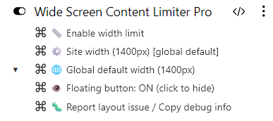

# Wide Screen Content Limiter

[](https://github.com/goloveshko/ultrawide-page-limiter)
[](https://opensource.org/licenses/MIT)
[](#установка)

> Простое и удобное ограничение ширины веб-страниц для ультрашироких (21:9, 32:9) мониторов с умной адаптацией верстки для YouTube, Gmail, GitHub и других сложных веб-приложений.

[🇬🇧 Read in English](README.md)

---

## 📖 О проекте

При чтении сайтов на ультрашироких или супер-ультрашироких мониторах текст часто растягивается от края до края экрана: длинные строки утомляют глаза, а шея затекает от постоянных поворотов головы из стороны в сторону.

**Wide Screen Content Limiter** возвращает контент в комфортную центральную область экрана на заданную ширину, бережно сохраняя структуру многоколоночных приложений, боковых панелей и полноэкранного воспроизведения видео.

---

## ✨ Возможности

- **⚡ Без мерцания верстки (`@run-at document-start`):** Применяет стили еще до завершения отрисовки страницы, полностью исключая визуальные прыжки контента при загрузке.
- **🎨 Реактивные CSS-переменные (`--uw-max-width`):** Мгновенное изменение ширины страницы на лету без пересоздания тегов стилей и перезагрузки вкладки.
- **🛡️ Изоляция кнопки через Shadow DOM:** Плавающая кнопка управления находится внутри изолированного **Shadow DOM** и рендерится CSP-безопасным способом (`textContent`, без `innerHTML`) — не конфликтует со стилями сайтов и не блокируется строгими политиками Trusted Types.
- **🌗 Авто-припарковка:** Через 2,5 секунды бездействия кнопка плавно уезжает к правому краю экрана, оставляя тонкий полупрозрачный язычок, — она больше не перекрывает интерфейс сайта. При наведении курсора кнопка мгновенно возвращается.
- **🎬 Поддержка полноэкранного режима:** Автоматически скрывает кнопку и снимает любые ограничения ширины (на все 100% экрана) при просмотре видео в полноэкранном режиме.
- **📐 Гибкая иерархия настроек:** Персональная ширина для домена → Глобальная ширина по умолчанию → Резервные `1400px`.
- **🧩 Умные адаптации сайтов:** Отдельные правила для сложных SPA-приложений:
  - **YouTube:** Центрирует сетку видео и плеер на странице просмотра, поддерживает режим кинотеатра и разворачивает видео на 100% экрана в полноэкранном режиме.
  - **Gmail:** Сохраняет целостность навигационного меню, кнопки «Написать» и белой карточки со списком писем единым блоком с помощью современных селекторов `:has()`.
  - **GitHub и Яндекс:** Центрирует шапки, поисковые строки и рабочие области.
  - **Универсальный fallback:** Контейнер с безопасным свойством `overflow-x: clip` и контекстом позиционирования для всех остальных сайтов интернета.
- **🐛 Встроенная диагностика верстки:** Сканирование проблемной страницы в один клик с автоматическим копированием готового Markdown-отчета в буфер обмена и переходом к созданию тикета на GitHub.

---

## 🚀 Установка

1. Установите менеджер пользовательских скриптов для вашего браузера:
   - [Tampermonkey](https://www.tampermonkey.net/) (рекомендуется для Chromium и Firefox)
   - [Violentmonkey](https://violentmonkey.github.io/)
2. Нажмите на ссылку ниже для установки скрипта:
   - **[Установить Wide Screen Content Limiter](https://raw.githubusercontent.com/goloveshko/ultrawide-page-limiter/main/ultrawide-page-limiter.user.js)**
3. Подтвердите установку в открывшемся окне менеджера скриптов.

---

## 🎮 Использование

### Плавающая кнопка (правый нижний угол)

Виджет обеспечивает мгновенную визуальную индикацию и быстрое переключение:

| Выключено (вся ширина) | Включено (ограничено) | Управление |
| :---: | :---: | :--- |
|  |  | • **Левый клик:** Вкл / Выкл ограничение<br>• **Правый клик:** Задать ширину (в пикселях) |

> **Авто-припарковка:** через 2,5 секунды бездействия кнопка уезжает к правому краю экрана, оставляя тонкий полупрозрачный язычок. Наведите курсор на язычок — кнопка вернётся.

### Команды меню расширения

Доступ к быстрым действиям через значок Tampermonkey / Violentmonkey на панели инструментов браузера:

<p align="left">
  
</p>

- 📏 **Enable / Disable width limit:** Включение или отключение ограничения для текущего сайта.
- ⚙️ **Site width (`...px`):** Задать персональную ширину для текущего сайта. Введите `0` или `reset`, чтобы вернуться к глобальной ширине по умолчанию.
- 🌐 **Global default width (`...px`):** Задать ширину по умолчанию для всех новых сайтов.
- 👁️ **Floating button visibility:** Показать или скрыть плавающую кнопку глобально.
- 🐛 **Report layout issue / Copy debug info:** Просканировать чистую нативную верстку сайта, скопировать отчет в буфер обмена и открыть страницу создания Issue на GitHub.

---

## 🐛 Как сообщить о проблеме с сайтом

Наткнулись на сайт, верстка которого ломается или выглядит криво при ограничении ширины?

1. Откройте меню расширения на проблемном сайте.
2. Нажмите **`🐛 Report layout issue / Copy debug info`**.
3. Скрипт на миллисекунду отключит ограничение, замерит оригинальные ориентиры страницы и скопирует готовый Markdown-отчет в буфер обмена.
4. Нажмите **ОК** в диалоговом окне для перехода на страницу тикета GitHub и просто вставьте отчет (**Ctrl + V**)!

---

## 🛠️ Добавление правил для новых сайтов

Добавить персональное правило для любого сайта очень просто благодаря декларативному массиву `SITE_RULES`:

```javascript
{
    name: 'ExampleSite',
    match: (domain) => matchesDomain(domain, 'example.com'),
    css: `
        .main-container,
        header {
            max-width: var(--uw-max-width) !important;
            margin-left: auto !important;
            margin-right: auto !important;
        }
    `
}
```

Пулл-реквесты с адаптациями для новых популярных сайтов горячо приветствуются!

---

## 📄 Лицензия

Проект распространяется под открытой лицензией [MIT License](LICENSE).

---

## 👨‍💻 Автор и поддержка

Разработано с ❤️ [Sergey Goloveshko](https://sergey.is-a.dev) — **AI & Systems Engineer**.

- **Портфолио**: [sergey.is-a.dev](https://sergey.is-a.dev)
- **Бот поддержки в Telegram**: [@itz2bot](https://t.me/itz2bot?start=ultrawide_page_readme)
- **Сообщить о баге**: [GitHub Issues](https://github.com/goloveshko/ultrawide-page-limiter/issues)